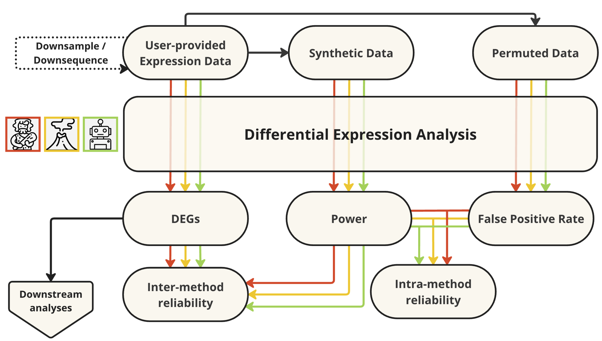

**ZUZU is a work in progress!**

After a user provides a gene expression dataset, Zuzu will operates on that dataset as follows. Note that except where the output of one step is necessary input for a later step, each step is run in parallel, allowing the overall pipeline to run very quickly in a cluster environment. 
1. Differentially-expressed genes (DEGs) between a pre-specified set of conditions are identified using every analysis method individually. Notably, if the user wishes simply to identify DEGs for their dataset, either from a single method or as a consensus across multiple methods, this step alone streamlines that process to a single command. 
2. The phenotype labels are permuted between intact sample profiles while the original group sizes remain unchanged. Every analysis method receives the same label assignment for a given replicate, and the count matrix itself is not altered; sample-wide library-depth and composition effects, cross-gene covariance, batch structure, and other sample-level properties are therefore retained. Assignments with an absolute correlation of 0.6 or more with the original binary labels are excluded so that a replicate cannot reproduce either the original grouping or its near-reversal too closely. Each method is then applied to the relabelled data to provide an empirical negative-control check under phenotype-label exchangeability. Because this is a deliberately restricted permutation space, the discovery counts are diagnostic rather than formal unrestricted permutation-inference results, and they do not estimate what fraction of the baseline DEGs are false. This step is repeated a number of times specified by the user in order to account for stochastic effects of permutation.
3. The original input dataset is subjected to a quasi-permutation procedure in order to assess each method's internal self-consistency in identifying high-confidence DEGs. In brief, differential expression analysis for each method is re-run with a very conservative threshold for DEG identification, permitting the generation of a set of very high-confidence DEGs with each method. A random half of these 'true' DEGs are retained, while expression values for all other genes are shuffled independently across the selected samples. This generates a new dataset consisting of a small number of high-confidence 'true' DEGs and a larger number of permuted genes that should exhibit no phenotypic signal. DEGs for this quasi-permuted dataset are generated once again through the given method, and the resulting set of DEGs are compared against the known 'true' DEGs. These data are then used to calculate three key benchmarks for the given method: Power, the proportion of true positives correctly classified by the method (against its own criteria); False Discovery Proportion (FDP), the proportion of false positives among all DEGs identified by the given method; and Youden's index, the anchor-recovery rate minus the background-call rate at the fixed DEG threshold. These method-specific quantities describe how consistently each method recovers its own high-confidence anchors after perturbation. They may be examined across sample sizes within a method, but should not be interpreted as comparative measures of accuracy between methods. The analysis is retained at every sample size even when the stringent discovery step produces few anchors. Rows with one to ten retained anchors are marked `low_anchor_count` when background genes remain because their recovery estimates are necessarily coarse; rows with no anchors are marked `no_anchors`, with power and Youden's index left undefined. This whole step is performed repeatedly to account for stochasticity in permutation and choice of high-confidence DEGs.
4. The original input dataset is used as a template to generate a synthetic expression dataset with the requested reference- and alternative-group sizes and an approximate sequencing depth; currently this step is achieved using the compcodeR package in R. compcodeR accepts only one per-condition sample size, so Zuzu first generates both groups at the larger requested size and then uses seeded sampling to reduce each group to its exact requested count before analysis. Because this is a wholly synthetic dataset, true DEGs are known prima facie and Power, FDP and Youden's index can be directly compared across methods (rather than simply as measures of self-consistency, as in the Step 3 quasi-permutation). In addition to calculating these metrics for each method across a range of sample sizes as in Step 3, the synthetic dataset can be altered to increase or decrease its read depth, allowing the user to assess whether particular methods perform well with more or less sparse data.

When `mlstep` is enabled, the SVC branch should be interpreted separately from the conventional differential-expression tests. It reports SVC-RFECV candidate features selected for discriminating the two phenotype labels; these features do not have gene-wise p-values or false-discovery-rate control and should not simply be called DEGs. The current implementation applies `log2(CPM + 1)`, fits scaling inside each cross-validation training fold, maps the requested reference to class 0, and uses a linear SVC with balanced class weights and balanced accuracy. Its initial fixed defaults are `C = 1`, five shuffled stratified folds, seed 1729, an RFE step of 50 genes, and a minimum of one feature. `svc_c`, `svc_class_weight`, `svc_scoring`, `svc_folds`, `svc_seed`, `stepsize`, and `njobs` can be overridden for a prespecified fixed-parameter run; the resolved settings are retained with every model. See [`SVC_BENCHMARK_SPECIFICATION.md`](SVC_BENCHMARK_SPECIFICATION.md) for the interpretation and safeguards required before tuning or making comparative claims.

SVC tables, feature-selection curves, fold assignments, plots, metadata, selected-feature counts, and fitted raw-count prediction bundles are published under `outdir/svctables`. The table preserves the complete filtered analysis gene universe and uses `selected_feature`, while coefficients are retained only as multivariable model diagnostics rather than expression-effect directions.

Before QC and the baseline, null-permutation, and quasi-permutation analyses, Zuzu retains genes with at least 1 count per million in at least as many samples as the smaller phenotype group. The required prevalence therefore reflects the available replication, but the identities of the samples in either group do not affect which genes pass. All downstream methods receive this same filtered gene set. If the filter removes more than half of the input genes, `CLEANINPUTS` reports a warning containing the removed and total gene counts; the run continues unless no genes remain. The full-synthetic branch currently follows a separate filtering path, as described by KI-016.

Quasi and synthetic benchmark rows retain the complete confusion matrix (`true_positives`, `false_positives`, `true_negatives`, and `false_negatives`) together with tested, called, truth, and background gene counts. Here `n_tested` denotes the fixed input gene universe: genes receiving an unavailable adjusted p-value after method-internal filtering remain in that universe and count as uncalled. Quasi rows with one to ten retained anchors are fully evaluated and marked `low_anchor_count` when background genes remain. When no anchors are retained, the method is still run and the call counts and FDP remain available, but power and Youden's index are `NA` and the row is marked `no_anchors`. If no background genes remain, Youden's index is instead `NA` under `youden_undefined_no_background`. FDP is defined as zero when a method makes no calls; power and Youden's index are also zero in that case only when both truth classes exist. A synthetic benchmark must contain at least one true DEG and one background gene, and every saved truth gene must remain in the generated count matrix. Per-replicate results are published as `quasi_results.csv` and `synth_results.csv`; synthetic rows record `refnum`, `altnum`, and their `totalnum`, and the plot labels each sample-size pair explicitly. The quasi plot uses distinct symbols for adequate, low, and empty anchor sets, while `synth_summary.csv` reports each full-precision mean together with the valid, total, and no-call replicate counts.

## Quick smoke test

Run `./tests/smoke.sh` from any directory to exercise input cleaning, QC, the three non-ML baseline methods, null permutation, quasi-permutation, aggregation, and plotting. The smoke run derives an intentionally unbalanced input from the compact tracked synthetic fixture. Sentinel genes verify the common CPM/prevalence filter and its high-removal warning, while further checks verify that null replicates preserve the count matrix and phenotype-group sizes, satisfy the label-correlation constraint, and remain keyed consistently across methods. The test also verifies every quasi sample-size pair and checks that its confusion-matrix counts, metrics, status, and combined result table agree exactly, including focused contract checks for zero and low anchor counts. By default it disables SVC and full-synthetic benchmarking and keeps all work and outputs in a temporary directory.

Nextflow and a running Docker daemon are required. Valid plots and `quasi_results.csv` from the latest successful run are copied to `tests/.smoke-plots/`, which is ignored by Git. Failed runs are retained for inspection; set `KEEP_SMOKE=1` to retain a successful run's complete temporary work tree as well. Set `SMOKE_NPERMS=5` for the slower path that also exercises and retains `permute_violins.pdf` as a real PDF. Set `SMOKE_SYNTH=1` to additionally exercise the non-ML full-synthetic analyzers, their aggregate CSVs, and `synth_plot.pdf`; this path also verifies that every generated dataset has the requested 11+9, 20+16, or 30+24 group sizes, unique sample identifiers, and sample-sheet/count-column alignment. It substantially increases runtime.

Set `SMOKE_SVC=1` to exercise one pared baseline SVC fit and one fit per requested null permutation. This path checks the class mapping, pre-filter library sizes, fold-local estimator structure, actual feature-count curve, complete output universe, saved raw-count prediction bundle, reference-majority and reference-minority designs, and clear rejection of a phenotype group smaller than the fold count. Its inspectable artifacts are retained under `tests/.smoke-plots/svc/`. Run `SMOKE_SVC=1` and `SMOKE_SYNTH=1` separately; combining them is deliberately rejected because it would add nine full-synthetic SVC fits to the smoke run.
